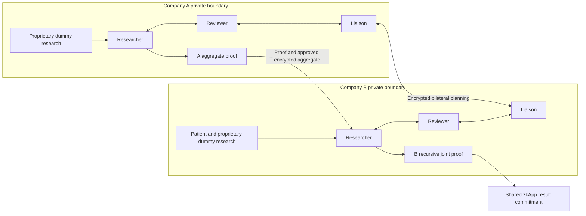

# Private research collaboration demo

Two fictional research companies collaborate through private SantaClawz-style workshops and a shared o1js zkApp on a local Zeko development network. Each company has three roles: liaison, researcher, and reviewer. Only the liaisons participate in the bilateral planning channel.

This is a synthetic engineering demonstration. Its arithmetic has no clinical meaning. It does not establish legal compliance, patient identity, or medical accuracy.

## Dashboard and one-command demo (v0.4)

Start with [QUICKSTART](docs/QUICKSTART.md) and the bundled [project skill](skills/research-collaboration/SKILL.md). From this directory, `python3 demo.py --mock` starts two isolated company harnesses, real application proofs on native Zeko and three scoped dashboards. Use `--gemma` for actual local inference; `--review` and `--routing` enable the optional controls. Both remain off by default. `--fast` explicitly disables cryptographic proofs. If a model answers from stale context without acting, the harness permits one corrective model prompt after a fresh idle-and-authorized status check; it never submits a scripted turn. Any corrective prompts are counted in each harness result’s `modelReprompts` field.

The [walkthrough](docs/DEMO.md), [operations guide](docs/OPERATIONS.md), [Reclaim integration](docs/IDENTITY.md), [separate-host deployment](docs/TWO_HOSTS.md) and [outside-developer handoff](docs/HANDOFF.md) are included. Live provider credentials, two physical hosts and an outside reviewer are pending. Local tests do not stand in for those checks.

Validation includes real Gemma with native Zeko proof enforcement, the interactive dashboard/controls test, and fresh-archive agent-directed onboarding. See [TESTED.md](TESTED.md) for exact modes, evidence and known limits.

The following lower-level commands remain available.

## Run

Use Node 20.19+, npm, and running OrbStack/Docker. From this directory:

```sh
npm ci --ignore-scripts
npm test
npm run zeko:up
npm run demo:zeko
```

This default path starts no Mina or Ethereum node and submits no L1 batches. The source package is Apache-2.0; see [LICENSE](LICENSE), [NOTICE](NOTICE), and the retained vendor licenses. Dependencies, container images, the Antigravity SDK, and separately installed Gemma weights keep their upstream licenses.

For quick checks without the Docker network, `npm run demo` is an explicitly labeled simulation with proofs disabled. `demo:proofs` generates real proofs, verifies them, deploys a proof-gated contract to `Mina.LocalBlockchain({ proofsEnabled: true })`, updates its state, reads it back, and checks rejection of a repeat submission. First compilation can take several minutes. It uses one proving worker per process and runs the company computations sequentially.

The `demo:proofs` local ledger is ephemeral and in-process. It has no persistent GraphQL endpoint, consensus, DA layer, or Zeko-to-L1 settlement. The JSON report always identifies the selected mode.

The package starts two separate company worker processes. This separates application data flow but is not an OS security boundary against another process running as the same user. For container filesystem/network separation, use the optional worker mode below.

## What happens



1. A's researcher discusses the plan with A's reviewer in `a-internal`.
2. A's reviewer passes its disclosure policy to A's liaison.
3. B's researcher and reviewer do the same in `b-internal`.
4. The two liaisons exchange an encrypted proposal and acceptance in `bilateral-planning`.
5. Both companies verify simulated organization/patient attestations and bind their handshake digest, case, algorithm, input commitments, output policy, and one-run budget into the plan.
6. A computes a bounded aggregate over its four private dummy research rows and proves it.
7. A releases only the approved aggregate and its commitment opening, encrypted to B's liaison.
8. B verifies A's proof recursively and combines that aggregate with B's private research and synthetic patient feature.
9. Both synthetic organization keys sign the exact settlement context, including the deployed contract address.
10. The shared contract verifies B's recursive proof and both signatures, then records the result commitment exactly once.

The first demo deliberately uses an aggregate that A is allowed to disclose. Arbitrary evaluation of A's secret model on B's secret patient requires additional private joint-computation machinery such as MPC. ZK alone does not supply that computation.

## Proof statement

The fixed `synthetic-support-v1` algorithm computes:

```text
A_total = sum(A's four bounded research scores)
B_total = sum(B's four bounded research scores)
supported = A_total + B_total + B's bounded patient feature >= 500
```

Every score is constrained to 0..100. A proves its aggregate against a salted dataset commitment. B proves its own dataset and patient commitments, verifies A's proof under the fixed circuit, verifies the opening of A's aggregate, and commits to the final boolean with a fresh random salt. A never receives B's patient feature or research rows. B receives A's approved aggregate, not A's research rows.

The chain receives case/plan/input commitments through the proof statement, organization public keys, signatures, and a result commitment. It does not receive the final boolean, raw records, patient identifier, prompts, or channel transcript. Dataset commitments are company-approved snapshots; this demo does not prove that the synthetic records came from an external source or that a source was complete or truthful.

The org signatures are automatic synthetic preauthorization, not human approval. The model's prose is never treated as a proof of inference or a diagnosis. The fixed circuit performs the computation.

## Private workshops and reuse

The original implementation was found under SantaClawz's **Team/Org Coordination Bridge**, **Private Workshop Channels**, **Inter-Agent Swarm Protocol**, and **Slack Export Local Workspace Connector**. The connector imports Slack exports locally; it is not a live Slack bot or Slack Connect integration.

This package reuses the actual Apache-licensed SantaClawz envelope builder/digester and AMBA capability/holder-event verification code. Source revisions and transformations are in [vendor/sources.json](vendor/sources.json); original licenses are retained. It adds a small local transport instead of starting the full SantaClawz marketplace/indexer. Protocol compatibility here is the envelope format and authorization primitives, not a claim that the entire hosted Workshop API has been reproduced.

Each directed envelope uses X25519 key agreement, HKDF-SHA256, and AES-256-GCM with authenticated routing metadata. An AMBA Ed25519 holder event binds the envelope digest to an authority-signed, channel-scoped capability. The relay validates enrollment, channel membership, sender binding, case, expiry, message budget, and replay before storing ciphertext. Keys are freshly generated and remain inside each company process. The local relay sees routing metadata; encryption does not hide who communicates or when.

Preliminary idea messages use scripted templates. Optional company-local Gemma advice can explain or hold each role's turn. Internal transcripts and model advice stay in the respective company's `.local` directory. The bilateral channel carries explicitly permitted templates and derived outputs. No Slack connection is needed.

Inspect each company's administrator report after a run:

```sh
npm run admin:report -- a
npm run admin:report -- b
```

Each report contains its own internal room and bilateral send/receive summaries, private model advice, and simulated identity status. It excludes the other company's internal room and aggregate commitment openings. With SSH workers, run this command on the respective company host. The coordinator's `.local/admin-overview.json` contains progress, envelope counts, and checkpoint status without room contents. These local files are access-controlled by the OS; this is not a separate administrator login service.

## Optional checkpoints — off by default

[config/demo.json](config/demo.json) contains:

```json
{
  "humanReview": {
    "enabled": false,
    "checkpoints": ["plan_agreement", "before_compute", "before_disclosure", "before_settlement"]
  },
  "modelRouting": { "enabled": false }
}
```

The workflow accepts injectable `review` and `route` callbacks. Tests exercise approval, denial, missing handlers, and invalid routes. With review off, checkpoints record `disabled`, never `approved`. With it on and no handler configured, execution stops. Routing suggestions are constrained to the configured roles and the authority of the current step; dynamic task-graph changes are a later extension. These switches do not disable authentication, encryption, disclosure restrictions, agreement checks, or replay prevention.

Magic City browsing/ordering, real zkTLS verification, and x402 payments remain disabled adapter slots. Enabling an unconfigured slot fails. The separately labeled dummy identity adapter below runs in every demo; it does not turn on the real `zkTLS` integration. A later Magic City adapter should receive only approved public queries, with a distinct review before ordering. Payment should bind the same case/result commitment, amount, beneficiary, and idempotency identifier.

## Simulated identity endpoint and handshake

`src/identity.mjs` starts an authenticated loopback HTTP adapter with the backend. Its ephemeral endpoint, bearer token, and public issuer key are written to `.local/identity-adapter.json` (mode 0600). It stops with that session. Requests use `Authorization: Bearer <token>` and JSON:

| Endpoint | Request | Result |
| --- | --- | --- |
| `POST /v1/challenges` | `caseId`, `org` (`a` or `b`), opposite `audience`, Ed25519 public `holderKey` JWK | One-time nonce, holder-key hash, case/audience binding, five-minute expiry. |
| `POST /v1/presentations` | Exact `challenge`, permitted `claims`, and `holderSignature` | Issuer-signed, one-hour presentation explicitly marked `simulated: true`. |

The bundled workers perform this exchange automatically. Claims bind each synthetic organization to its enrolled agent registry, chain key, and dataset commitment. B also presents a salted patient-ID commitment, the patient computation commitment, and dummy predicates: ID present, age at least 18, and condition matching `synthetic-H1`. Raw patient ID, age, condition, and research rows remain at B. The permitted predicates themselves are disclosed to A and the local dummy issuer; they are part of the agreed disclosure policy.

Both companies check signatures, nonce/context binding, expiry, registry membership, and the agreed commitments. The presentation digest enters the plan commitment used by the real application proof and organization signatures. **The circuit does not verify zkTLS, KYC, age, or condition proofs.** The dummy issuer signs self-asserted synthetic claims, and its trust key is supplied by the coordinator. This demonstrates the handshake and binding, not externally established identity.

For a real provider, replace the issuance/verification implementation behind this interface, pin trusted issuer keys independently, verify transcript/credential-to-predicate binding, and add revocation. Unknown presentation schemes currently fail closed. See `test/identity.test.mjs` for HTTP replay, wrong-holder, wrong-case/audience, expiry, tampering, and raw-field rejection checks.

## Antigravity + local Gemma

The Python adapter targets Google's Antigravity SDK 0.1.10 and an already-installed local Gemma served by an OpenAI-compatible endpoint supporting tool calling. It creates six separate agent conversations and exposes scoped MCP tools. The deterministic workflow selects whose turn it is; Gemma performs that role's tool calls and explanation. A separate, optional company-local adviser can return `proceed` or `hold` with a private rationale before each action. Human review and bounded model routing are off by default; the v0.4 launcher can enable them with `--review` and `--routing`.

### Reproduce the bundled mock test

No model weights are required for this test. It exercises the actual SDK, six agent conversations, twenty MCP calls, ten advisory calls, long-running real proof execution, identity handshake, administrator reports, and Zeko state acceptance:

```sh
python3 -m venv .venv
.venv/bin/pip install -r antigravity/requirements.txt
npm run zeko:up
.venv/bin/python antigravity/run_fixture.py --zeko
```

The runner starts and stops its own scripted OpenAI-compatible model server and demo backend. Do not run another backend in the same package directory concurrently. It writes `.local/harness-validation.json`. Use `--proofs` for real proofs with the in-process ledger, or no flag for a faster proof-disabled simulation. The fixture is bundled in `antigravity/model_fixture.py`; it validates transport and orchestration, **not Gemma intelligence**.

### Use an installed Gemma model

Start the backend in one terminal:

```sh
AGENT_INTELLIGENCE=gemma GEMMA_MODEL='<your-installed-gemma-model>' npm run serve:zeko
```

In another terminal, with Python 3.10+:

```sh
python3 -m venv .venv
.venv/bin/pip install -r antigravity/requirements.txt
GEMMA_MODEL='<your-installed-gemma-model>' .venv/bin/python antigravity/run.py
```

The SDK transport was tested with Python 3.12.16. `antigravity/requirements-lock.txt` records the resolved versions. The historical v0.2 run had no Gemma installed. Version 0.3 completed a real Gemma 4 E2B run through two independent company harnesses with native Zeko state acceptance; see TESTED.md for evidence and limits. The mock test now includes real proofs through the SDK, including the final Zeko transaction.

The default model URL is `http://127.0.0.1:11434/v1`. Set `GEMMA_BASE_URL` or company-specific `GEMMA_A_BASE_URL`, `GEMMA_B_BASE_URL`, `GEMMA_A_MODEL`, and `GEMMA_B_MODEL` in both terminals as needed. There is no cloud-model fallback. Built-in web, filesystem, shell, and subagent tools are disabled. If the model fails to call the required tool, the harness reports failure instead of substituting a scripted success.

`AGENT_INTELLIGENCE` defaults to `off`; `gemma` enables the adviser inside each company worker, and `mock` is reserved for the fixture. Advisory prompts contain only the current role, fixed action, and disclosure policy. No raw records, transcripts, or proof openings are sent. Advice stays in the private administrator report; only the decision returns to the coordinator. Invalid advice, unavailable model endpoints, or a `hold` stop the session. A model cannot change roles, expand permissions, alter the circuit, or grant human approval. This is bounded model assistance, not autonomous research or model-inference proving.

The SDK's lazy MCP dispatcher is supported explicitly in the role prompt, so no filesystem tool is needed to discover schemas. Each role receives only its own MCP server and the two allowed tools. Antigravity may also expose its own harness bookkeeping/resource tools. Run one backend session at a time from a package directory; `.local` contains that session's files.

Per-agent access files are generated with mode 0600 under `.local/company-a` and `.local/company-b`. Each MCP process receives one scoped file. The loopback API exposes only `status` and `turn`; it never exposes raw datasets. The default driver runs both sets of conversations locally. With `--company a` or `--company b`, independent processes on company hosts run only their own three agents and wait for the peer’s turn. Do not expose the loopback API publicly.

Official references: [local models](https://antigravity.google/docs/sdk/local-models/), [MCP configuration](https://antigravity.google/docs/sdk/mcp/), [tool configuration](https://antigravity.google/docs/sdk/tools/).

## Native Zeko localnet on OrbStack

The `zeko-localnet/` stack runs the published **Zeko v1.0.5 `/bin/zeko-run-fake` development sequencer**, with its native persistent ledger, PostgreSQL, RabbitMQ, signer, a native DA node, and development rollup prover. The healthcare zkApp uses real o1js proofs. Start it with:

```sh
npm run zeko:up
npm run demo:zeko
# For Antigravity + your local Gemma server instead:
npm run serve:zeko
```

Zeko GraphQL listens at `http://127.0.0.1:19230/graphql`. `npm run zeko:ready` checks Zeko-specific `sequencerPk` and `signatureKind` fields; a Mina endpoint cannot pass this check. Use `LOCAL_ZEKO_GRAPHQL` only to select a different loopback Zeko endpoint. Existing public-network environment variables are not used.

This is a **Zeko L2 execution development profile**, with native ledger execution and native zkApp proof verification. It uses matched `zeko-run-fake` / `zeko-prover-fake` binaries for development rollup-proof formats, DA quorum zero, and disabled L1 batch commits. The `fake` rollup binaries do not make the application proofs fake: the test requires the native node to reject an altered application proof before accepting the valid update.

**Neither Mina nor Ethereum is a runtime dependency.** This pinned v1.0.5 binary still requires a Mina-shaped bootstrap API even with commits disabled. `metadata-fixture.mjs` supplies only the required synthetic genesis/fork/account metadata and empty action/pending-command responses. It makes no outbound network requests and rejects mutations. Native checkpoint recovery creates the genesis DA history. The adapter is not a blockchain, bridge, settlement contract, or proof of L1 state. Do not enable commits on this profile.

Current Zeko's [Ethereum Sepolia rollup guide](https://docs.zeko.io/operators/guides/launch-sepolia-rollup) uses an Ethereum settlement gateway with a Mina-compatible GraphQL facade. API shape does not imply a Mina settlement dependency. This lightweight demo retains the previously tested v1.0.5 development binary; it does not claim to validate the current Ethereum production stack. The single local DA service with quorum zero provides no replicated availability or L1-finality guarantee.

The test submits an altered proved transaction to Zeko before the valid one, requiring the node to reject its proof. It then verifies the accepted contract state. The Zeko ledger is mounted under `.local/zeko/ledger`; PostgreSQL and queue state use named volumes. Restarting the sequencer retains them. Stop this stack with `npm run zeko:stop`; the separate Lightnet service can be stopped with `docker compose --profile chain stop lightnet`. Initialization retains existing identities and refuses to overwrite a partial ledger.

The pinned Zeko image is x86_64 and was tested through OrbStack emulation on Apple Silicon. The stack uses Docker service DNS and no `host.docker.internal`, so the previous Linux host-mapping issue is removed. Linux native-bootstrap files are created with the invoking user's UID/GID. A clean Linux-host run remains unvalidated; Windows/WSL is also unvalidated. These are portability checks, not requirements to demonstrate the tested macOS setup. Full rollup proving is unnecessary for this demo.

For a second isolated localnet, set `COMPOSE_PROJECT_NAME`, `ZEKO_PORT`, and matching `LOCAL_ZEKO_GRAPHQL` in a separate copy of the package before running `zeko:up`. Each copy needs its own `.local` state. `npm run zeko:smoke` submits a signature-only update and reads back `42`; use `demo:zeko` for actual proof-gated state.

## Separate company hosts

Yes: the company worker protocol now supports authenticated SSH, with pinned host trust and encrypted stdin/stdout transport. Use two independent company hosts, or one company host plus another host with the coordinator co-located on A. Install this package and Node dependencies on each worker host, give it only its own fixture/data directory, and configure SSH aliases and verified `known_hosts` on the coordinator. The coordinator runs the local Zeko stack.

Copy and edit `examples/company-hosts.json` with each SSH alias, absolute package directory, and installed model name. Use `"intelligence": "off"` and omit model fields to test without Gemma. Then, on the coordinator:

```sh
COMPANY_REMOTE_CONFIG=/absolute/path/company-hosts.json npm run demo:zeko
# To drive the same backend through Antigravity:
COMPANY_REMOTE_CONFIG=/absolute/path/company-hosts.json npm run serve:zeko
```

Each worker loads only its company's files, generates proofs locally, and retains its own transcript/result/admin files. Its advisory model endpoint resolves on that company host's loopback interface. Raw research and patient data are not part of the worker RPC responses. Only public commitments/proofs, encrypted envelope packets, signatures, and small status responses cross the SSH connection; the approved A aggregate is released encrypted to B.

Run `antigravity/run.py --company a` on A and `--company b` on B. Each needs only its own three scoped access files, a local model endpoint, and an SSH tunnel to the shared coordinator API. Use `--access-dir`, `--state-dir`, and `--result-file` to select company-local paths. The coordinator remains the shared scheduling/relay service; there is no central cross-company model driver in this mode. No two-physical-machine run has been completed. This topology still trusts the coordinator's enrollment and scheduling, and does not establish production organizational separation or legal compliance.

## Reproduce two independent company harnesses locally (v0.3)

The mock and actual Gemma paths below passed both the original validation and a fresh unfamiliar agent's reproduction. The latter used fresh local company containers and a fresh Zeko ledger; commands were executed through the parent chat's approved runtime and independently assessed by the reproducing agent. See [validation](TESTED.md) and the [independent report](evidence/independent-reproduction/result/REPORT.md). That v0.3 release added those reports without changing its tested implementation; its historical per-file hash manifest remains with the report. Version 0.4 adds the dashboard, launcher and optional controls; see current validation in TESTED.md.

This profile runs two Linux container hosts over authenticated SSH. Each contains only its own dummy data, company worker, three agent credentials, private SDK conversations, and administrator reports. Each host runs its own Antigravity Python process. A coordinator relays encrypted envelopes, enforces the shared workflow and submits the final Zeko update. This is one physical machine, with a shared local model server forwarded into each company; it is not a claim of two independent physical machines or two separate inference servers.

Prerequisites: Node 20.19+, Docker Compose, Python 3.10+, SSH client/keygen, and for real inference an installed Ollama server/model. The successfully tested model is [`gemma4:e2b-it-q4_K_M`](https://ollama.com/library/gemma4/tags); its download is approximately 4.6 GB. The SDK uses its supported custom-system-instructions option to keep prompts focused on the two research tools. No model weights or inference runtime are bundled.

```sh
npm ci --ignore-scripts
npm test
npm run zeko:up
python3 -m venv .venv
.venv/bin/pip install -r antigravity/requirements.txt
.venv/bin/python -m unittest discover -s antigravity -p 'test_*.py'
python3 deployment/init_hosts.py
npm run hosts:up
# Mock model, real SDK and real application proofs on Zeko:
.venv/bin/python deployment/validate_local_hosts.py --mock --zeko
```

For actual Gemma, start a local Ollama server and install the pinned model tag:

```sh
ollama pull gemma4:e2b-it-q4_K_M
.venv/bin/python deployment/validate_local_hosts.py --zeko
```

Use `--model` and `--model-port` to select another installed Gemma or Ollama port. This validation runner queries Ollama's installed-model metadata and records its digest. It launches two independent company harnesses over SSH; it does not generate tool responses or choose their turns. The mock is enabled only by `--mock`. Use neither `--zeko` nor `--proofs` for a quick proof-disabled transport check; `--proofs` uses an in-process ledger. The default backend API port is 17410 and the local SSH ports are 22221 and 22222. Run one instance of this test at a time.

On a sandboxed Mac where Metal is unavailable, CPU inference can be started with the following environment (stop your existing Ollama server before starting another on the same port):

```sh
LLAMA_ARG_DEVICE=none LLAMA_ARG_N_GPU_LAYERS=0 \
OLLAMA_NO_CLOUD=1 OLLAMA_CONTEXT_LENGTH=8192 \
OLLAMA_NUM_PARALLEL=1 OLLAMA_MAX_LOADED_MODELS=1 OLLAMA_KEEP_ALIVE=30s \
ollama serve
```

This CPU configuration was exercised with Ollama 0.40.17. It keeps one model warm briefly between calls and unloads it during longer idle/proving periods; CPU runs are slower. Set `OLLAMA_KEEP_ALIVE=0` for minimum retained inference memory. The adviser requests bounded JSON without thinking, while the SDK model still decides its MCP calls. Invalid model output fails closed; there is no scripted fallback in the real-model path.

Results are written to `.local/distributed/validation.json`, with separate harness logs for A and B. Each company keeps its private admin report inside its container. Inspect it through the generated pinned SSH configuration:

```sh
ssh -F .local/ssh-hosts/config research-company-a 'cd /srv/research-collab-demo && npm run admin:report -- a'
ssh -F .local/ssh-hosts/config research-company-b 'cd /srv/research-collab-demo && npm run admin:report -- b'
```

The harness retries only read-only status requests during coordinator proof compilation, bounded by its deadline. It never automatically repeats a state-changing turn; authentication failures remain fatal.

The validation asserts five completed turns per company, independent harness ownership, absence of the peer's data/credentials, the room-summary boundaries, and final proof/state acceptance. It closes its backend, SSH tunnels, and harness launchers when finished; the container hosts and Zeko remain available. Stop only this test's hosts with `npm run hosts:stop`. Private SSH keys, tokens, SDK conversations, and all model files belong under `.local` or another private runtime directory and must not enter the public archive.

For physical company hosts, configure `COMPANY_REMOTE_CONFIG` and optional `COMPANY_SSH_CONFIG` on the coordinator, securely distribute only each company's own access files, and tunnel the loopback API with SSH. Start each company harness independently with `--company`. Their Gemma servers should then run on their own hosts; the shared-model forwarding in the container test is a local testing convenience.

## Optional Mina-only test backend

With OrbStack running and `docker ps` working:

```sh
npm run chain:up
npm run chain:status
npm run chain:ready
npm run demo:lightnet
```

The isolated demo ports are `127.0.0.1:18080/graphql` and account manager `127.0.0.1:18181`. This uses Mina Lightnet, not a Zeko sequencer. Lightnet uses its nonproduction `PROOF_LEVEL=none` mode; the app's own real proof generation and independent verification remain enabled. Node inclusion in this mode is not evidence of full protocol proof enforcement. An included transaction is not described as public-network finality.

Compose pins a January 2026 protocol-3 image by digest, matching the eight-field transaction format of o1js 2.13 used in the source projects. The moving `compatible-latest-lightnet` tag now uses protocol 4 and rejected these transactions with a vector-length mismatch. Upgrade o1js, circuits, evidence, and the node together when targeting current Mina; do not replace just the image tag. The worker's Node base image is also pinned by digest.

Lightnet keeps a running node's state across client process restarts, but this configuration does not promise ledger persistence across container removal or image replacement. Do not use it for real funds. Stop only this demo's container with `docker compose --profile chain stop lightnet`; do not reset OrbStack or remove unrelated volumes.

For stronger separation of the two company workers:

```sh
npm run workers:build
npm run demo:isolated
```

Each worker container receives only its company's fixture directory, output directory, and proving cache. The container root is read-only, network access is disabled, Linux capabilities are dropped, and it communicates with the relay through stdin/stdout. This does not isolate companies from a malicious host administrator.

Network-disabled Docker worker mode requires `AGENT_INTELLIGENCE=off`. For company-local model access with independent host isolation, use the SSH transport. SSH and Docker worker modes cannot be combined.

## Files and evidence

Saved public evidence is included under `evidence/`. Check it against the current circuit source:

```sh
npm run verify:evidence -- evidence/in-process
npm run verify:evidence -- evidence/docker-isolation
npm run verify:evidence -- evidence/lightnet
npm run verify:evidence -- evidence/zeko-localnet --node
npm run verify:evidence -- evidence/v2-standalone-harness --node
npm run verify:evidence -- evidence/v3-gemma-independent-harnesses --node
```

The last command independently verifies the saved real proof and reads the Zeko contract's case, result, and completion fields. It requires the corresponding persisted local ledger. The saved Mina Lightnet proof can be verified offline; its original contract may no longer exist after a Lightnet restart/reset.

`evidence/v2-standalone-harness` records the historical v0.2 SDK mock run with real application proofs and native Zeko state acceptance, without a live L1 dependency. Earlier directories retain historical v0.1 runs; the original `antigravity-transport` evidence used simulated proofs. Neither fixture is a Gemma intelligence test. Reproduction generates fresh keys, salts, addresses, and transaction hashes; matching the checks matters, not matching those random values.

- `.local/public-report.json`: shared result, commitments, mode, verification checks, and timing.
- `.local/public-evidence/`: real proof and verification key when real proving is enabled. Pin the verification key independently; a prover-supplied key is not a trust root.
- `.local/relay-ciphertext.json`: encrypted transport records and public authorization metadata.
- `.local/company-a/transcript.json`, `.local/company-b/transcript.json`: company-local messages.
- `.local/company-a/admin-report.json`, `.local/company-b/admin-report.json`: company-scoped room summaries and model advice.
- `.local/admin-overview.json`: coordinator progress without transcript contents.
- `.local/company-b/private-result.json`: B's result and private commitment opening.
- [REVIEW.md](REVIEW.md): reviewed local components, gaps, and the path to a full Zeko network.
- [TESTED.md](TESTED.md): completed checks and remaining integration limits.

Do not publish `.local`, proving caches, installed dependencies, or agent access files. The public evidence can reveal case-level linkage and activity; the commitment-only design is not a claim of anonymous metadata.
